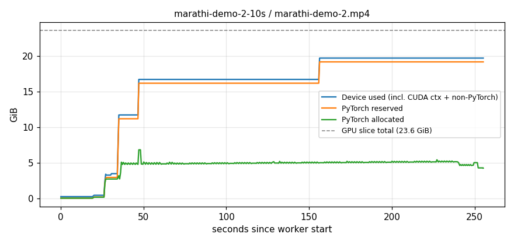

# LatentSync benchmark report

- Generated: 2026-10-31T15:30:53
- Host: `aicoeserver05`  |  Slurm job: 1568
- GPU: NVIDIA RTX PRO 6000 Blackwell Server Edition MIG 1g.24gb
- Settings: steps=20, guidance=1.5, deepcache=True
- LatentSync commit: a229c39
- Jobs: 1/1 succeeded

## Summary

| Input | Status | Video len | Audio len | Output len | Inference | Total wall | RTF | Peak VRAM (device) | PyTorch peak alloc |
|---|---|---:|---:|---:|---:|---:|---:|---:|---:|
| marathi-demo-2-10s | success | 15.0s | 10.0s | 10.1s | 255.1s | 260.9s | 25.3x | 19.73 GiB | 13.09 GiB |

RTF = compute seconds spent per second of output video (lower is faster).

## marathi-demo-2-10s  (success)

- Input video: `/home/aryannavale/projects/inputs/marathi-demo-2-10s/marathi-demo-2.mp4`: 15.02s, 1280x720 @ 24.0 fps, 360 frames, 13.34 MB
- Input audio: `/home/aryannavale/projects/inputs/marathi-demo-2-10s/marathi-demo-voice-2-10s.mp3`: 10.00s, 44100 Hz, 0.12 MB
- Output video: `/home/aryannavale/projects/outputs/bench-20261031-152743/latentsync/_raw_marathi-demo-2-10s/marathi-demo-2-latentsync.mp4`: 10.08s, 1280x720 @ 25.0 fps, 252 frames, 1.97 MB
- Timing: boot 4.1s, inference (model load + diffusion) 255.1s, total wall 260.9s
- Throughput: RTF 25.30x, 0.99 output frames per compute-second
- Length check: audio - output = -0.08s, video - output = 4.94s
- CPU RAM peak: 10833 MB

**GPU memory**

| Metric | MiB | Meaning |
|---|---:|---|
| GPU slice total | 24192 | memory of the MIG slice you were given |
| PyTorch peak allocated | 13408 | tensors actually in use (weights, latents, activations) |
| PyTorch peak reserved | 19656 | PyTorch caching allocator pool (allocated + cache) |
| Device used, start | 225 | before inference started (CUDA context) |
| Device used, peak | 20203 | everything on the slice, sampled every 0.5 s |
| Non-PyTorch overhead | 547 | device peak minus reserved: CUDA context, cuDNN workspaces, ONNX Runtime (InsightFace) |
| Headroom | 3989 | free memory at the peak (83.5% of slice used) |

